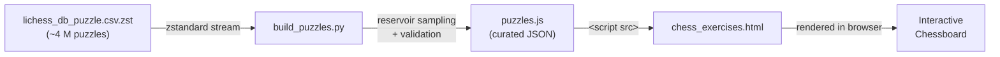
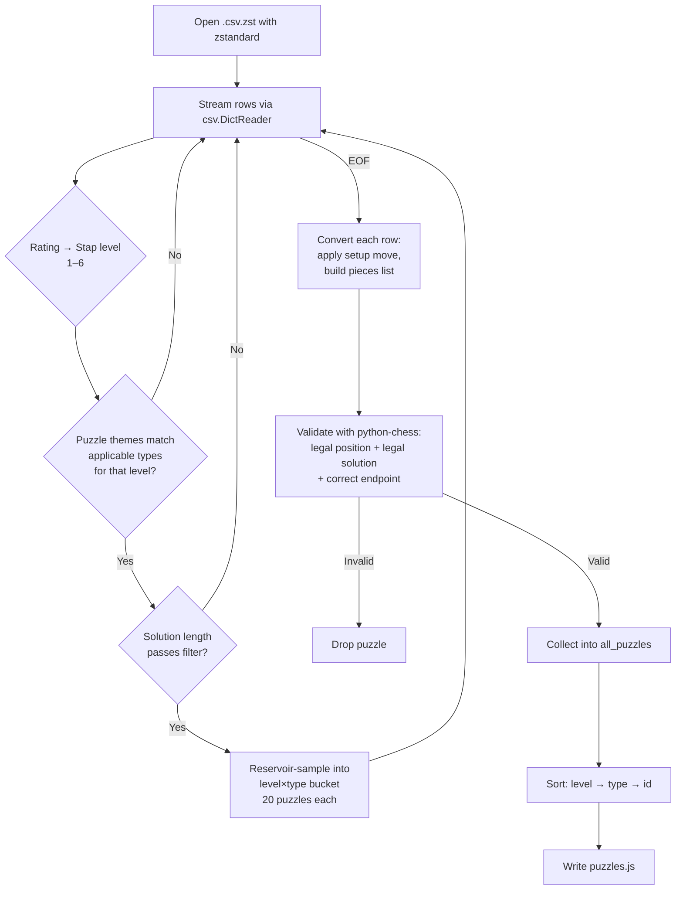
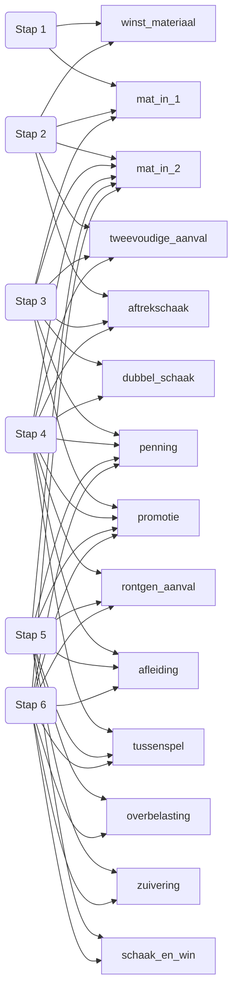
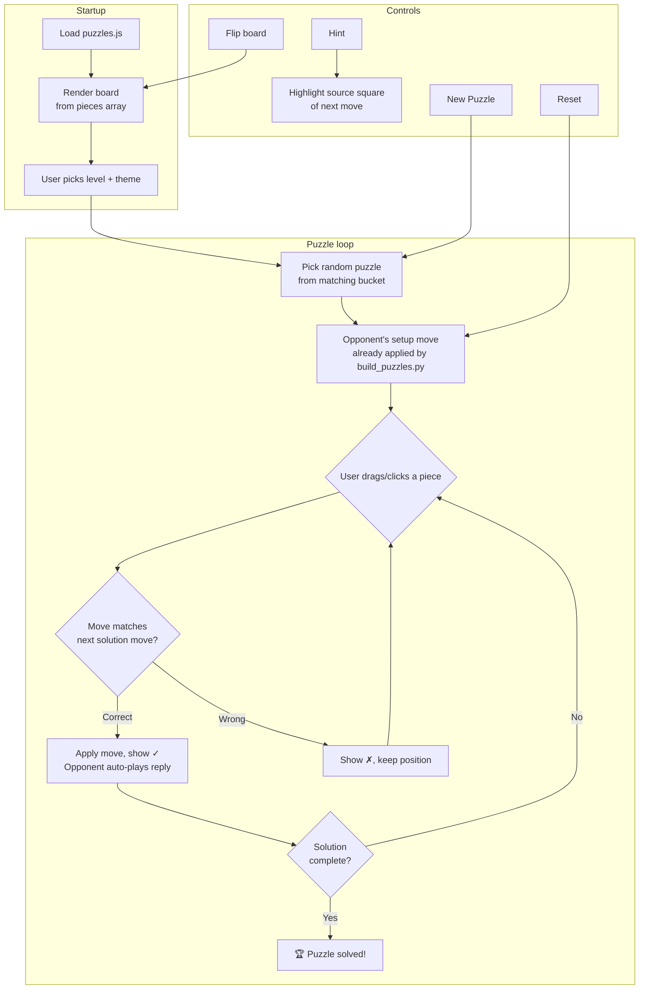

# Chess Exercises – Stappenmethode

An interactive, browser-based chess puzzle trainer aligned with the **Stappenmethode** (Steps Method) curriculum — the structured Dutch chess teaching system used widely in youth coaching. Puzzles are sourced from the [Lichess open puzzle database](https://database.lichess.org/#puzzles) (CC0 licence).

---

## Features

- 6 difficulty levels (Stap 1–6) matching the Stappenmethode progression
- 14 tactical themes: mate-in-1/2, fork, pin, discovered check, double check, promotion, intermezzo, skewer, deflection, decoy, overloading, clearance, and more
- Fully playable chessboard rendered in the browser — no server required
- Dutch / English UI toggle
- Hint, reset, and board-flip controls
- Move history with colour-coded correct/wrong moves
- Custom puzzle JSON upload for offline or curated sets
- Responsive layout (desktop and mobile)

---

## Repository structure

```
chess-exercises/
├── build_puzzles.py          # Offline data-pipeline: reads Lichess CSV → writes puzzles.js
├── lichess_db_puzzle.csv.zst # Lichess puzzle DB (zstandard-compressed, ~4 M puzzles)
├── puzzles.js                # Auto-generated puzzle data (committed output)
└── chess_exercises.html      # Self-contained frontend app
```

---

## How it works

### High-level pipeline



### Data pipeline — `build_puzzles.py`

The script processes the compressed Lichess CSV in a single streaming pass without loading it all into memory.



**Key design decisions:**

| Concern | Approach |
|---|---|
| Memory | Reservoir sampling keeps exactly 20 candidates per bucket while streaming |
| FEN handling | Custom Python parser; no library dependency during the scan |
| Validation | `python-chess` used for legal-move and checkmate verification |
| Determinism | `random.seed(20260523)` — re-running produces the same output |
| Non-queen promotions | Dropped (UI auto-promotes to queen) |

#### Level → theme mapping



### Frontend — `chess_exercises.html`

A single self-contained HTML file; everything runs in the browser with no build step.



#### Puzzle data format (inside `puzzles.js`)

```js
{
  id:       "lichess_AbCdE",   // "lichess_" + Lichess PuzzleId
  level:    3,                 // Stap 1–6
  type:     "mat_in_2",        // theme key
  turn:     "w",               // side to move ("w" or "b")
  pieces: [
    { sq: "e1", piece: "wK" }, // white King on e1
    { sq: "e8", piece: "bK" }, // black King on e8
    // ...
  ],
  solution: ["e2e4", "e7e5"],  // UCI moves the *player* must play (+ opponent replies)
  castling: "KQkq",
  ep:       null,              // en-passant target square or null
  rating:   1450,
  themes:   ["mateIn2", "backRankMate"],
  url:      "https://lichess.org/game/..."
}
```

---

## Setup & usage

### 1. Re-generate `puzzles.js` (optional)

> Only needed if you want to rebuild from the Lichess database.

**Requirements:**
```
python >= 3.9
pip install zstandard chess
```

**Download the puzzle database:**
```
https://database.lichess.org/#puzzles
→ save as lichess_db_puzzle.csv.zst in the workspace root
```

**Run:**
```bash
python build_puzzles.py
```

The script prints progress every 500 000 rows and a per-bucket summary at the end.

### 2. Open the app

No server required — just open `chess_exercises.html` in any modern browser:

```bash
# Windows
start chess_exercises.html

# macOS / Linux
open chess_exercises.html
```

Or serve it locally for a cleaner experience:
```bash
python -m http.server 8080
# then visit http://localhost:8080/chess_exercises.html
```

---

## Tactical themes reference

| Dutch name | English | Lichess tag(s) |
|---|---|---|
| winst_materiaal | Win material | `hangingPiece` |
| mat_in_1 | Mate in 1 | `mateIn1` |
| mat_in_2 | Mate in 2 | `mateIn2` |
| tweevoudige_aanval | Fork | `fork` |
| aftrekschaak | Discovered check | `discoveredAttack`, `discoveredCheck` |
| dubbel_schaak | Double check | `doubleCheck` |
| penning | Pin | `pin` |
| rontgen_aanval | X-ray / Skewer | `xRayAttack`, `skewer` |
| afleiding | Decoy / Attraction | `attraction` |
| overbelasting | Overloading / Deflection | `deflection` |
| promotie | Promotion | `promotion`, `underPromotion` |
| tussenspel | Intermezzo | `intermezzo` |
| zuivering | Clearance | `capturingDefender`, `clearance` |
| schaak_en_win | Check and win | `discoveredCheck` |

---

## Licence

Puzzle data: [Lichess open puzzle database](https://database.lichess.org/#puzzles) — **CC0 (public domain)**  
Code: see repository licence.
